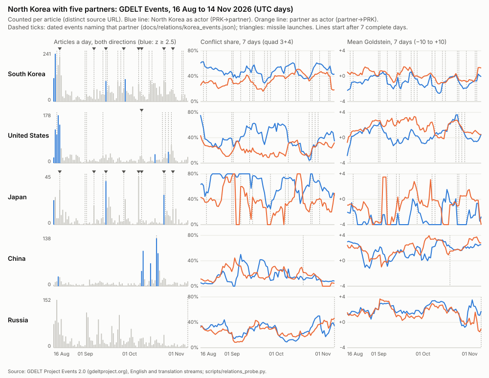

# Relations and tone: a probe on the Korean Peninsula (15 Nov 2026)

A design for Tom to approve, from a read-only prototype. Nothing here is deployed; no bucket, Firestore or Vertex
use. Tom's ask (15 Nov 2026): casualty counts are a small part of what matters; track relations between nations,
between people and their governments, how one country's people and press see another, and changes in tone, for
every zone, measured first on North Korea.

**Bottom line.**
- **Relations between countries (GDELT Events pairs): works; build it.** At z >= 2.5 on at least 5 articles it
  flagged 20 of 26 dated events, and 18 of the 20 flags with no listed event traced to real news the list had
  missed. Weekly measures show slow shifts Watchfloor cannot see today: South Korea's language toward the North
  hardened after the 21 Sep mine blast, and coverage of North Korea and China warmed in October. Japan's pair is
  too thin to read daily, and GDELT often gets direction and partner wrong, so pairs are read both ways together.
- **Press tone by outlet country (GDELT GKG): works for US and South Korean outlets** on North Korea (about 40
  articles a day each where it is the main subject), **too thin for Japanese, Chinese and Russian outlets** (3 to 5
  a day; weekly at best).
- **A state and its people (Events actor types): nothing for North Korea** (2 articles in 126 days by the strict
  rule, about 3 a day by a looser one). The looser rule has volume for about half the zones. North Korea's people
  need other sources (Temper, humanitarian).
- **Bellicosity of official statements stays with Readout;** Watchfloor would show Readout's series beside its own.
- **Cost:** free. About 0.9 MB a day more gzip in the cycle files (+5%), two small writes a day, no new services.

## What was run

- `scripts/relations_probe.py` (standard library; run with `python -I`; data under the git-ignored `data/`):
  - `fetch`: every GDELT Events 2.0 file, English and translation streams, 12 Jul to 14 Nov 2026 (126 days,
    192 files a day, about 20 MB a day; 11 to 24 s a day on Tom's connection). Per day it keeps per-pair tables for
    every country pair (70 to 118 KB gzip a day) and the raw rows that touch North Korea (about 25 KB gzip a day).
  - `series`: daily and 7-day values for North Korea with South Korea, the US, Japan, China and Russia, each
    direction, with z-scores against each series' own previous 28 days (`pipeline.measures.attention_anomaly`, log
    and weekday-adjusted, as for zone attention) and, for the 7-day means and shares, against the four weeks before.
  - `spikes`, `score`, `chart`: the articles behind each unusual day; hits and misses against a reference list;
    the SVG below.
  - `gkg-sample`: press tone by outlet country from GKG 2.1, one 15-minute file per hour, 1 to 14 Nov 2026
    (672 files, about 4.6 GB streamed, nothing kept but per-day aggregates).
- Reference events: 58 dated, sourced events for 16 Aug to 14 Nov compiled from Watchfloor's stored stories (28 Sep
  to 13 Nov) and web searches; the 29 used for scoring are in `docs/relations/korea_events.json`; sources and
  confidence for each are in the file named under "Reference events and sources" below.
- Unit of count: **one article (distinct source URL) per country pair**. GDELT codes several events from one
  article (a Korea Herald piece on 13 Nov became six events in both directions), and its NumArticles weighting
  counts the reprints of each event's first 15 minutes, so summing it multiplies one story. Both are kept in the
  files; the series use articles.

## Layer 1: relations between countries (Events pairs)

Articles a day with a coded event between the two, 16 Aug to 14 Nov 2026 (91 days). "Both ways" adds the two
directions, so an article coded both ways counts twice:

| Partner | Both ways: mean (median; highest) | NK as actor | Partner as actor | Conflict share, NK to partner / partner to NK | Mean Goldstein, NK to / to NK | Days with none |
|---|---|---|---|---|---|---|
| South Korea | 50 (37; 241 on 17 Aug) | 25 | 25 | 49% / 34% | -0.9 / +0.1 | 0 |
| United States | 21 (13; 178 on 19 Aug) | 11 | 10 | 37% / 24% | +0.6 / +1.5 | 1 |
| Japan | 6 (3; 45 on 12 Oct) | 4 | 2 | 65% / 36% | -3.7 / -0.5 | 12 |
| China | 13 (7; 138 on 24 Oct) | 6 | 7 | 14% / 17% | +1.9 / +2.0 | 1 |
| Russia | 26 (16; 152 on 18 Aug) | 15 | 11 | 28% / 25% | +2.0 / +1.6 | 0 |

The asymmetries match the record: North Korea's actions toward the South are coded far more hostile than the
South's toward the North (a Lee government seeking talks), China and Russia are cooperative both ways, and Japan's
pair is mostly missile launches coded as force against Japan.

**Against the reference events** (`score`; flag = z >= 2.5 on at least 5 articles, on daily articles both ways or
on either direction's verbal or material conflict articles; matched within one day):
- **Caught 20 of 26:** 15 in the named partner's series and 5 only in another partner's (the 20 Aug barrage
  flagged on the US pair because the Korean pair was already high from the exercise run-up). Looser (z >= 2, no
  floor): 25 of 26 with 105 flagged partner-days. Stricter (z >= 3, at least 10 articles): 18 of 26 with 23.
- **Missed 6:** the destroyer commissioning (6 Sep) and the party anniversary (10 Oct), which are domestic and have
  no pair; Freedom Edge (7 Sep), where North Korea is not an actor; Kim Yo Jong's rejection of the UN
  Secretary-General (10 Nov), because the UN is not a country in the pair table; the revised constitution (11 Nov,
  12 articles on the Korean pair); and Jo Yong-won's arrival in Moscow (14 Nov, a Saturday, against a Russia
  baseline of 26 articles a day).
- **43 flagged partner-days.** 23 had a listed event for that partner within a day. The other 20, judged from the
  headlines of the articles GDELT coded (`spikes`; not opened):
  - 8 were listed events filed under another partner or two days out (launches on the US pair, the Ulchi Freedom
    Shield cut announced 16 Aug, the Dandong visit's second day, the death rumours, the prisoners sent to Seoul).
  - 10 were real news the list missed: the New Yalu River Bridge opening, 14-15 Oct (AP via News4Jax, Nikkei Asia,
    Hankyoreh); Trump seeking a November summit, 19 Aug (AP via Anchorage Daily News, Korea Times); North Korea's
    envoy denouncing US support for a South Korean nuclear submarine, 29 Sep (NK News, Korea Herald); Reuters'
    "little chance" of a Trump-Kim meeting this year, 22-23 Oct; a suspected North Korean IT worker found at a South
    Korean firm, 23 Oct (Korea Times); Zelensky's claim of 10,000 more North Korean troops, 29 Sep (Khaama, Digi24);
    North Korean women and workers sent to Russian factories, 18 Sep and 29 Oct (Livemint; Straits Times, The
    Independent, Kyiv Post); North Korea's answer to a report of troops for Russia, 20 Aug.
  - 2 were mostly miscoding: 17 and 22 Aug, North Korea "against Japan" from stories about Trump's exercise cut and
    Japan's defence budget.
- **Compared with today's measure:** Watchfloor's Korea attention (headline-filtered stories, z >= 2) flagged one
  day between 12 Oct and 14 Nov (24 Oct, Dandong); stored attention has a z only from 12 Oct.

**Slower shifts** (weekly, per article; `series` writes the 7-day values and their z):
- **South Korea hardened after the mine blast.** Verbal conflict (accuse, demand, reject, threaten) was 9-14% of
  South Korea-to-North Korea articles in the five weeks to 20 Sep and 25-33% in five of the six weeks from 28 Sep.
  The pair's tone fell from about -1.3 in August to -3.3 (week of 28 Sep) and -3.8 (week of 19 Oct). This fits
  the record: the UN Command's armistice finding, Seoul's demand for an apology and its letters to the Security
  Council.
- **North Korea and the US:** North Korea's verbal conflict toward the US was 50% of articles in the weeks of
  28 Sep and 5 Oct, 11-16% in the three weeks of APEC summit talk (12-26 Oct; mean Goldstein +2.5 in the week of
  19 Oct), and 36% in the week of 2 Nov (the Binance denial). The tone of US-to-North Korea articles fell from
  -0.9 in August to -4.6 in the week of 2 Nov.
- **China warmed in October:** 15-32 North Korea-to-China articles a week through September, then 76 and 176 in the
  weeks of 12 and 19 Oct (bridge, Dandong), with mean Goldstein +3.2 and +2.1 and conflict under 12%.
- **Russia stayed cooperative** (Goldstein +1.3 to +3.5 in most weeks). Its conflict counts come mostly from
  stories about the two countries' cooperation (troops, workers) coded as conflict between them.
- **Bellicosity proxy** (North Korea as actor toward anyone, verbal conflict): 12-17% of articles in most weeks of
  September to mid-October, 22-27% from 26 Oct to 14 Nov; the Binance denial is part of the late rise. This is
  what the press reports North Korea saying, not a reading of the statements themselves (see layer 4).

## Layer 2: a state and its people (Events actor types)

- **North Korea: nothing.** 93% of North Korean actors carry no type code (53,797 of 57,647 actor slots, 12 Jul
  to 14 Nov); in 126 days, 2 articles had a North Korean state actor acting on North Korean people and none the
  reverse. A looser rule (event placed in the country, one actor a state type and the other a people type,
  each actor's country the same or blank) gave 3 articles each way on 13 Nov.
- **Elsewhere the looser rule has volume** (13 Nov 2026, articles state-to-people / people-to-state): India
  180/149, Russia 140/97, Ukraine 106/64, China 94/75, Israel 61/55, Pakistan 38/29, Iran 34/35, South Korea 32/25,
  Venezuela 27/21. Thin: Myanmar, Sudan, Ethiopia, Syria, Lebanon, Somalia, DR Congo (2 to 5). The strict rule
  (both actors coded to the same country) is near zero everywhere except the US (about 15 a day).
- **What happens to North Korea's people** is not in the news GDELT reads: in the GKG sample, articles mainly about
  North Korea carried FOOD_SECURITY in 0.5% and REFUGEES in 0.2%; 62% were CYBER_ATTACK (the Binance theft). The
  event search found no dated floods, executions, food reports or defections for the window. Sources that would
  carry it (UN Special Rapporteur reports, NK News and Daily NK, defector arrival statistics, WFP and FAO) belong to
  the planned Temper (society) and humanitarian programs, not to a GDELT layer.

## Layer 3: how one country's press writes about another (GKG tone)

Per article: the outlet's country (GDELT's 2018 domain table, which files an outlet under the country it judged
the outlet to belong to: 98% of GKG articles matched; corrections for nknews.org, a specialist outlet the table files
under North Korea, and kcna.co.jp), every country its locations name, and whether that country is the one named
most. Estimated per day from the 1-in-4 sample, 1 to 14 Nov:

| Outlets in | about North Korea: articles naming it | as the main country | mean tone (main) | about South Korea: as the main country | mean tone (main) |
|---|---|---|---|---|---|
| United States | 127 | 47 | -4.3 | 111 | -0.2 |
| South Korea | 103 | 36 | -4.2 | 1,264 | -0.7 |
| Germany | 32 | 18 | -4.9 | 18 | -1.0 |
| Russia | 23 | 5 | -4.1 | 22 | -1.7 |
| China | 17 | 3 | -2.6 | 81 | +0.1 |
| Japan | 12 | 3 | -4.0 | 25 | +0.9 |

- **Workable:** US and South Korean outlets on North Korea (daily, with 7-day means); every listed country's
  outlets on South Korea. **Too thin for a daily read:** Japanese, Chinese and Russian outlets on North Korea; a
  weekly read is the most they support, and GDELT's translation stream samples those languages.
- Tone is a dictionary score on English or machine-translated text. It differs by language and outlet mix, so each
  outlet country is read against its own baseline, never against another country's level.
- One story can own the measure: 13 Nov's US articles (39 in the sample) were mostly the US freeze of funds from
  the Binance theft (Livemint, TechRadar, 13 Nov).
- Events offers a cheaper version (the tone of the one article that first reported each event, by its outlet), but
  over 1 to 14 Nov it gave 25 South Korean, 18 US, 6 Russian, 2 Chinese and 0.4 Japanese articles a day about North
  Korea, against the GKG's estimated 103, 127, 23, 17 and 12. The GKG is the better source, and Watchfloor already
  downloads it every 15 minutes.

## Layer 4: bellicosity of official statements (Readout, not built)

Readout (planned; `doctrine/kit/vocab/programs.json`) owns official statements. Watchfloor's verbal-conflict series
measures what the press reports North Korea saying, which is a different thing: a Kim Yo Jong statement carried by
KCNA alone is invisible to it until outlets pick it up. Watchfloor would read Readout's feed through the "From the
suite" panel and show the two together: statements rising while press pickup is flat (unreported escalation), or
press rising without statements (press-driven). It would not score statement text itself.

## Proposed design (for approval)

**Built 15 Nov 2026 on Tom's yes, pair layer only** (branch `relations-tone`; not merged or deployed):
`pipeline/relations.py`, `catalog/relations.json`, `GET /relations`, the zone page's "Relations between countries"
panel and `scripts/backfill_relations.py`, as described below with two changes: the state-and-people `within` table
and the GKG `press` rows are not built, and the API computes z and flags from the series on read instead of storing
them. `CLAUDE.md` has the summary.

**Computed in the 15-minute cycle, from files it already downloads:**
- `events.record()` gains `dyads`: per directed pair for that file, the article-level vector (articles; by quad;
  any conflict; Goldstein and tone sums per article; lead-paragraph articles) plus the looser state-people
  `within` table. Measured on 13 Nov: 71 pairs a file on average, 0.33 MB a day gzip for all 192 files.
- The GKG pass gains a `press` row per file: per outlet country and named country, articles naming it, their tone
  sum, articles where it is the main country, their tone sum, kept only where the named country is a zone country
  or a major outlet country (43 FIPS codes): 1.6 KB (English) and 4.3 KB (translation) gzip a file, about
  0.56 MB a day. The domain table goes in `catalog/` trimmed to domains GDELT actually sends (the full 2018 table
  is 189,545 domains, 5.6 MB; size the trimmed one before shipping).
- Together about 0.9 MB a day against the bucket's ~17 MiB a day (+5%); 5 GB still lasts into 2027. No extra
  writes: both ride in the cycle file the run already writes. Memory: a few thousand small dict entries per run.

**Built daily (one more write each):**
- `stories/YYYY/MM/DD/relations.json`: the day's pair, within and press tables summed from the cycle rows.
- `relations/series.json`: a rolling 120 days for the pairs each zone names, with the daily and 7-day values and
  z-scores, rewritten once a day. The build reads it plus one day (not 28 daily files), so Class B stays flat;
  Class A rises by about 60 a month against an estimated ~3,350 in use (`HISTORY.md`, cost audit) and 5,000 free.

**Catalog:** each zone gains a `relations` block, for example
`{"pairs": [["PRK","KOR"],["PRK","USA"],["PRK","JPN"],["PRK","CHN"],["PRK","RUS"]], "press": {"about": ["KN"],
"outlets": ["US","KS","JA","CH","RS"]}}`. GDELT actors use CAMEO (ISO 3166 alpha-3) and locations use FIPS, so
`scripts/build_fips_iso.py` adds alpha-3 from the same Natural Earth file.

**API (mc-api, reads one cached file):**
- `GET /relations?zone=03_Korea_Peninsula&days=90`: for each pair, both directions, daily articles, verbal and
  material conflict articles, 7-day conflict share, Goldstein and tone, their z-scores, and the press table.
- `GET /relations?pair=PRK-KOR&days=120`: one pair in full.
- The zone page gets a "Relations" panel (small multiples like the chart above), display only, as zone violence
  started. No new alarm and no `/feed` items until Tom sets thresholds after a month of reading it.

**Measures to show, and the rule for flagging a day (proposed):**
- Flag a pair-day at z >= 2.5 with at least 5 articles on the flagged count (daily articles both ways, or either
  direction's verbal or material conflict articles).
- Show the 7-day conflict share, Goldstein and tone as lines with their z, not as flags, until they are tested the
  same way.
- Revisit after a month of reading; z >= 3 with at least 10 articles is the candidate if it ever becomes a coding
  trigger.
- Add the UN and other intergovernmental actors as partners (GDELT's known-group codes) so a day like 10 Nov is not
  missed, and a focus-country series (North Korea toward anyone) for news with no clear partner.

## GDELT's noise and limits, as seen in this probe

- **Direction is unreliable.** "North Korea condemns South Korea's nuclear submarine plan" was coded South Korea
  criticising North Korea (13 Nov, koran-jakarta.com); meetings are coded twice, once each way. Read pairs both
  ways together and treat direction as a hint.
- **Coding errors:** the sentencing of a former South Korean president was coded South Korea using military force
  on North Korea (DW Russian, 27 Jul); a story about the FBI and a crypto theft gave US-North Korea threats.
- **Small numbers:** the median day has 18-19 articles each way for South Korea, 6-9 for the US and Russia, 3 for
  China and 1-2 for Japan, so daily z on conflict counts swings on two or three articles; the count floor in the
  flag rule matters more than the z.
- **One story dominates:** the Binance theft drove North Korea-US coverage from 29 Oct to 13 Nov, and 62% of the
  GKG articles mainly about North Korea in 1 to 14 Nov. The measure says attention moved, not why.
- **Coverage gaps:** GDELT carries no wire services (Watchfloor audit, 31 Oct 2026), samples non-English press
  through its translation stream, and does not read KCNA or Rodong Sinmun directly; what North Korea says reaches
  it only through other outlets.
- **Timing:** Korea is UTC+9, so a launch before 09:00 KST falls on the previous UTC day (3 Oct 06:36 KST was
  2 Oct 21:36 UTC); the reference list and the series are both UTC, and matching allows one day either side.

## Reference events and sources

- `docs/relations/korea-events-2026-08-16_to_11-14.md`: 58 dated events with outlets, links, publication dates and
  a confidence grade, compiled 15 Nov 2026 by a research agent from Watchfloor's stored Korea stories (28 Sep to
  13 Nov, GET only) and about 25 extended web searches. Its limits, stated in the file: search summaries rather
  than every article opened; launch counts conflict between outlets; nothing found for floods, executions, food,
  defections, balloons or GPS jamming in the window (balloons and jamming were not searched directly, so those are
  untested, not quiet); Japan MoD, JCS, KCNA Watch, 38 North and CSIS were not searched directly.
- `docs/relations/korea_events.json`: the 29 of them used for scoring and the chart (26 in the window), each with
  the partners it names.
- The 10 events the list missed (layer 1) are cited from the headlines of the articles GDELT coded, listed by day
  in `data/relations/series/spikes.txt` after a run; they were not opened.
- Data: GDELT Project Events 2.0 and GKG 2.1 raw files (https://www.gdeltproject.org), and GDELT's
  MASTER-GDELTDOMAINSBYCOUNTRY-MAY2018 domain table.

## Reproduce

    python -I scripts/relations_probe.py fetch --start 2026-07-12 --end 2026-11-14 --root data/relations
    python -I scripts/relations_probe.py series --root data/relations
    python -I scripts/relations_probe.py score --root data/relations --events docs/relations/korea_events.json --start 2026-08-16 --end 2026-11-14 --z 2.5 --min-count 5
    python -I scripts/relations_probe.py spikes --root data/relations
    python -I scripts/relations_probe.py chart --root data/relations --start 2026-08-16 --end 2026-11-14 --events docs/relations/korea_events.json --out docs/relations/korea_relations.svg
    python -I scripts/relations_probe.py gkg-sample --start 2026-11-01 --end 2026-11-14 --root data/relations

`fetch` and `gkg-sample` need GDELT's domain table at `data/relations/ref/domains_by_country_2018.txt` (download it
once from the address in the script's `DOMAINS_URL`). About 25 minutes for `fetch` and 10 for `gkg-sample` on Tom's
connection; `fetch` holds a day's parsed rows in memory (about 0.5 GB).
